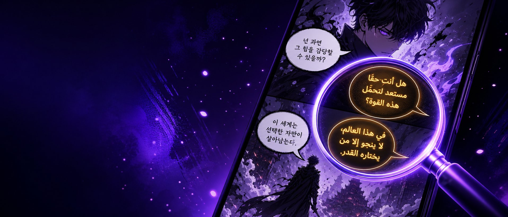

<div align="center">



# ManhwaLens

**اقرأ المانهوا بتُرجمة فورية — على هاتفك مباشرة.**

Read any manhwa, translated in seconds — entirely on your phone.

[](https://github.com/mouadknight0-cell/ManhwaLens-v2/actions/workflows/ci.yml)
[](https://github.com/mouadknight0-cell/ManhwaLens-v2/releases/latest)
[](LICENSE)
-34D399)


**[📲 تحميل آخر نسخة APK مباشرة | Download the latest APK](https://github.com/mouadknight0-cell/ManhwaLens-v2/releases/latest)**

</div>

---

## ✨ ما هو ManhwaLens؟ | What is ManhwaLens?

ManhwaLens تطبيق **Android أصلي (Native)** يعمل فوق أي قارئ مانهوا: تلتقط الشاشة عبر `MediaProjection`، تتعرف على نص الفقاعات بالمحلية عبر **ML Kit OCR** (كورية · يابانية · صينية · لاتينية)، ثم تترجمه فوراً بـ 16 لغة — الافتراضية **العربية** — دون أي خادم ودون مفاتيح API.

ManhwaLens is a **native Android** overlay that reads English dialogue on screen and renders it in natural Arabic — no server, no API keys, no data ever leaves your device. (v1.1 locks the pipeline to EN→AR; KO/ZH support returns after the EN→AR pipeline is device-proven.)

## 📱 مميزات | Features

- **عدسة عائمة (Floating lens bubble)** — زر عائم قابل للسحب فوق أي قارئ؛ نقرة واحدة تُلتقط الصفحة وتُترجمه فوراً.
- **ترجمة فوق الصفحة (Translation overlay)** — لوحة سفلية تعرض كل فقاعة: نصها الأصلي وترجمتها، مع نسخ لأي سطر أو للكل.
- **معالجة محلية 100%** — التعرف على النصوص والترجمة يعملان على الجهاز (ML Kit). السجلّ يُخزَّن داخل مساحة التطبيق فقط.
- **جلسات التقاط مُدارة** — MediaProjection داخل foreground service بنوع `mediaProjection` مع إشعار دائم وزر إيقاف.
- **خصوصية كاملة** — لا تحليلات، لا تتبع، لا رفع للصور. يمكن مسح السجل في أي وقت.
- **متتبع معايير T0–T12** — زمن حتى أول جملة عربية وحتى الشاشة الكاملة، قابل للتصدير من الإعدادات.
- **واجهة عربية وإنجليزية** مع دعم RTL كامل، ووضع ليلي.
- **History** — كل التقاط يُحفظ محلياً مع صورة مصغرة وقابلة للحذف.
- **حماية الأسماء الصينية والكورية** — تُكتشف تلقائياً وتُحفظ Romanized ولا تُترجم أبداً؛ تتراكم عبر الفصول.

## 📥 التثبيت | Install

1. نزّل **`app-release.apk`** من [صفحة الإصدارات](https://github.com/mouadknight0-cell/ManhwaLens-v2/releases/latest).
2. افتح الملف على هاتفك واسمح بالتثبيت من مصادر خارجية عند الطلب.
3. عند أول تشغيل: اسمح بـ **النافذة العائمة** و **الإشعارات** ثم انقر **«ترجمة الشاشة الآن»** أو ثبّت العدسة العائمة وانقرها داخل قارئ المانهوا.

> Android 8.0+ (API 26). نماذج الترجمة (~30MB لكل لغة) تُنزَّل مرة واحدة ثم تعمل دون إنترنت.

## 🔐 الأذونات | Permissions

| الإذن | لماذا |
|---|---|
| `INTERNET` | تنزيل نماذج ML Kit مرة واحدة فقط (الترجمة تعمل دون اتصال بعدها). |
| `FOREGROUND_SERVICE` + `FOREGROUND_SERVICE_MEDIA_PROJECTION` | جلسة التقاط الشاشة أثناء القراءة. |
| `FOREGROUND_SERVICE_SPECIAL_USE` | الفقاعة العائمة (`manhwalens_translation_overlay`). |
| `SYSTEM_ALERT_WINDOW` | رسم العدسة فوق التطبيقات الأخرى (إشعار + إيقاف من أي مكان). |
| `POST_NOTIFICATIONS` (Android 13+) | إشعار جارٍ أثناء الجلسة/العدسة. |

Frames are processed in memory and never written to shared storage; only on-demand JPEG thumbnails of translated pages are kept in app-private history, and you can clear them anytime.

## 🏗 البناء من المصدر | Build from source

Requirements: **JDK 17**, Android SDK 34, or simply push a tag and let [GitHub Actions](.github/workflows/release.yml) build it.

```bash
./gradlew testDebugUnitTest   # JVM unit tests (pipeline logic)
./gradlew assembleDebug       # debug APK
./gradlew assembleRelease     # release APK (see docs/RELEASING.md for signing)
```

### بنية المشروع | Layout

```
app/src/main/java/com/manhwalens/app/
├── MainActivity.kt            # navigation, permissions, consent launchers
├── ManhwaLensApp.kt           # Application + notification channels
├── capture/                   # MediaProjection session, frame grabbing, consent trampoline
├── ocr/                       # ML Kit script-aware recognizers (ko/ja/zh/latin)
├── translate/                 # ML Kit on-device translation + LRU cache
├── overlay/                   # Floating bubble service + result panel
├── pipeline/                  # Pure Kotlin: filtering, bubble merging, history JSON — unit tested
├── history/                   # On-device history store (JSON index + thumbnails)
├── settings/                  # StateFlow-backed settings repository
└── ui/                        # Compose screens (Home / History / Settings / Onboarding / Result)
```

See [docs/ARCHITECTURE.md](docs/ARCHITECTURE.md) for the capture flow, and [docs/RELEASING.md](docs/RELEASING.md) for the signing/release process.

**Current test build:** [1.1.42-rc3](docs/RELEASE-CANDIDATE-1.1.42-rc3.md) — signed release APK,
versionCode 217442872, direct `.apk` link and SHA-256 in that file.

## 📦 التوقيع وإدارة الإصدارات | Signing & releases

- **Package id** `com.manhwalens.app` and the **release signing key are permanent** across releases — updates always install over the previous version.
- Tags `vX.Y.Z` trigger the release workflow: tests → signed `app-release.apk` → GitHub Release with the APK attached.
- CI injects `VERSION_NAME` (from the tag) and `VERSION_CODE` (workflow run number).

## 🗺 خارطة الطريق | Roadmap

- [ ] Auto-capture loop while scrolling (accessibility-driven pacing)
- [ ] Vertical (tategaki) text support for Japanese
- [ ] Per-bubble retranslate on zoom
- [ ] Bubble-style rendering of translations *inside* the page (inpainting)
- [ ] Export/import history

## 🤝 المساهمة

Issues and PRs welcome — see [CHANGELOG.md](CHANGELOG.md) and the issue tracker. Please keep pipeline logic pure (JVM-testable) and UI in Compose.

## 📄 الترخيص

[MIT](LICENSE) © 2026 mouadknight0-cell
